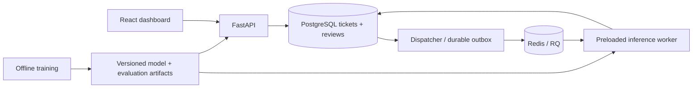

> Current release: see [ROBUSTNESS.md](ROBUSTNESS.md). Serving uses the balanced word/character candidate with automatic routing disabled. Earlier model-selection and routing measurements below describe the original release.

# Architecture and operations



Postgres is the source of truth. Submission commits a ticket and its unique idempotency key before any queue operation. The ticket row also acts as the durable outbox, keeping infrastructure small. Reusing a key with changed normalized request text returns 409; identical replay returns the same ticket. Both sequential and simultaneous replays are tested.

The dispatcher scans due queued tickets or expired processing leases every second with `FOR UPDATE SKIP LOCKED`. It enqueues an importable task with the expected attempt number and advances the dispatch deadline within one DB transaction. A Redis acknowledgement lost before DB commit can cause repeated delivery; it cannot lose the committed ticket. Redis outages roll back dispatch state, and bounded socket timeouts prevent an indefinite lock. Redis AOF and a named volume are configured in Compose.

Workers claim under a row lock, increment attempts, assign a random fencing token and lease deadline. Delivery with a stale expected attempt is ignored. Concurrent delivery during a live processing lease is ignored. Results and exceptions can update only the owning token. A stale inference cannot overwrite a recovered/reviewed ticket. Completion stores model version, raw prediction, confidence, threshold, assigned team, routing snapshot, inference latency, and timestamps. Reviews store category/team/reviewer/note independently and leave the raw prediction intact.

Failures receive exponential database backoff (5, 10, 20 seconds; at most three actual inference attempts). Third failure is terminal. A hard-killed worker leaves a processing lease that the dispatcher redelivers after 90 seconds. RQ's timeout is 60 seconds, deliberately shorter than the lease. Dispatcher acknowledgement leases and worker processing leases protect separate stages. Model loading and config errors are retried like other job errors; no exception includes ticket content in application logs. RQ failed-job records have a seven-day TTL. A missing routing rule triggers human review rather than an arbitrary team.

Linux: the worker preloads the sklearn pipeline once before RQ forks a workhorse, so children inherit the model. Windows: the installed RQ SpawnWorker attempted `os.wait4`, which is unavailable. The portable worker uses a supervised persistent SimpleWorker; a daemon timer forcibly exits its entire child process with code 124 after a job timeout. The supervisor restarts the child, loading once per lifetime, while Postgres recovers the lease. This also interrupts a stuck native inference call. Windows SimpleWorker heartbeats can be stale during a job; timeouts/leases, not heartbeats alone, govern correctness. Keep the child supervised. Only the Linux process worker is configured in Compose.

Readiness checks schema access, Redis connectivity, artifact presence, and routing-label completeness. Liveness only confirms the API process is serving. API readiness does not certify worker availability: inspect RQ workers and growing oldest-ticket age separately. `/api/metrics` reports counts, total attempts, terminal failures, mean queue wait, mean inference latency and review rate. Queue wait means time from original submission to the latest inference claim; for retries it includes backoff. Inference excludes DB time, scheduling, model load, and HTTP polling. End-to-end benchmark includes all of those plus polling delay.

Commands (run in the project environment):

```bash
rq info --url redis://localhost:6379/0
python -c "from app.jobs import queue; from rq.registry import FailedJobRegistry; q=queue(); print(FailedJobRegistry(queue=q).get_job_ids())"
curl 'http://localhost:8000/api/tickets?status=failed&limit=100'
curl http://localhost:8000/api/metrics
```

For failed-job details, use `rq.job.Job.fetch(job_id, connection=queue().connection)` and inspect `exc_info` locally. Application ticket rows expose sanitized exception type, attempt count and status. The dashboard has a Failed filter. No automatic retry endpoint for terminal failures is provided: an operator investigates before creating a new explicit request/key. Feedback never initiates automatic retraining.

API contract: `POST /api/tickets` requires `Idempotency-Key` and `{text}` (8–5,000 trimmed characters); `GET /api/tickets` supports status, limit 1–100 and offset; `GET /api/tickets/{id}` includes review history; `POST /api/tickets/{id}/review` requires known category and reviewer; `/api/model` returns the deployed metadata plus rules; `/api/evaluation` reads saved real reports. `/docs` and `/openapi.json` describe schemas. Errors use FastAPI's `detail` envelope; unexpected failures become sanitized 503 responses with structured error-type logs.

This is an unauthenticated, local portfolio application. Bind only to loopback. Before any shared deployment add authentication, reviewer authorization, TLS, abuse limits, secrets management, retention controls, and operational alerts. Never expose Redis, PostgreSQL, or RQ admin capabilities publicly. No paid services or external deployment were created.
